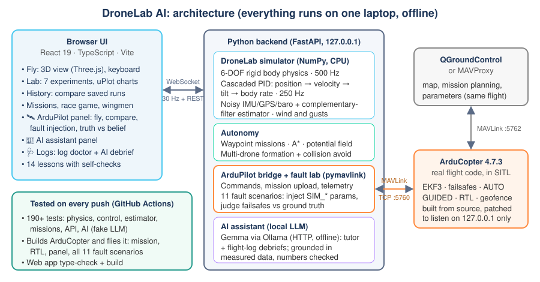
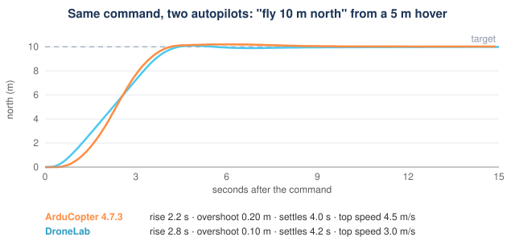

# DroneLab AI

**A drone-engineering lab that runs on one laptop, offline.** Fly a quadcopter simulator I wrote from scratch, then put the *real* ArduPilot autopilot next to it: same commands, side-by-side charts, and a fault-injection lab that breaks ArduCopter on purpose and checks that its failsafes do the right thing.

[](https://github.com/RahulPant1/DroneAILab/actions/workflows/ci.yml)
   



## Highlights

**1. My own flight stack, from physics up.** 6-DOF rigid-body physics at 500 Hz (NumPy), a cascaded PID controller (position → velocity → tilt → body rate, 250 Hz), simulated noisy IMU/GPS/barometer/compass with a complementary-filter estimator, wind and gusts, a GPS-loss failsafe, a LiPo battery model (voltage sag, less thrust as it drains, battery failsafe), waypoint missions with A* and potential-field obstacle avoidance, **sense-and-avoid with a simulated lidar** (it maps unknown obstacles and replans), multi-drone formation flight, and a **Drone Builder** that turns real-world parts into flight time and flies the result. All in the browser in 3D.

**2. The real ArduPilot, flying next to it.** ArduCopter 4.7.3 built from source and run in SITL (software-in-the-loop: the same flight code that runs on a real flight controller). DroneLab talks to it over MAVLink: take-off, fly-to, mission upload, return-to-launch, and a live comparison of both autopilots doing the same job. QGroundControl can join the same flight.



**3. Fault injection on the real autopilot.** 11 scenarios: GPS loss, GPS glitch, GPS spoofing, weak and dead motors (quad and hexa), radio loss, low battery, gusty wind, compass failure, geofence breach. Each run takes off, injects the fault with SITL's `SIM_*` parameters, records every mode change and message, compares where the EKF *believes* the drone is with where it *really* is, and judges the outcome.

| Result | |
|---|---|
| **Safety checks** | **8 / 8 passed**: e.g. radio loss → RTL in 1.1 s and landed 0.0 m from home; GPS loss → EKF failsafe → LAND; geofence → RTL |
| **Known limitations** | **3 / 3 reproduced**: a steady 20 m GPS offset is *believed* (the drone really flies 20 m off course); a quad with a dead motor falls in 1.7 s; a default-tuned hexa survives ~20 s but loses heading control |

Full report with a chart per fault: [docs/results/fault-injection.md](docs/results/fault-injection.md).

**4. A flight-log doctor with a local AI.** Open any ArduPilot `.BIN` log, from the simulator or **uploaded from a real drone**: it runs the checks a flight-test engineer would (vibration, EKF innovation ratios, GPS quality, attitude/altitude/position tracking, motor balance and saturation, battery, failsafes) and a local Gemma model writes a debrief: *what happened, most likely cause, what to check next*. The model sees only the summary, and every number it writes is checked against the data. [Example on a GPS-spoofing flight](docs/results/log-doctor-example.md).

**5. Farm surveys, precision landing and an AI mission planner.** Type *"Survey the north field, then land on pad B"*: a local Gemma model turns it into a task list (only names from the farm map, never coordinates), and code plans a lawnmower survey from the camera footprint and overlap, routes around tall buildings and no-fly zones with A*, and checks altitude, geofence, no-fly zones and battery before you can press Fly. The same plan flies in DroneLab **or uploads to real ArduPilot as an AUTO mission**: both covered 100 % of the field ([comparison](docs/results/survey-compare.md)). The landing uses a simulated down camera that finds the pad's marker: **0.31 m average miss vs 1.61 m on drifting GPS alone** (8 runs).

| You say (real local model) | Result |
|---|---|
| "Map the east field from 12 m and hover over the gate for 10 seconds" | ✅ survey at 12 m → hover 10 s → home |
| "Check the orchard at 25 m, then fly over the horse paddock" | ⚠️ paddock left out: no-fly zone |
| "Fly to the school and back" | ❌ not on the map |
| "Survey all three fields at 8 m" | ❌ battery: ~79 % of the pack, too little reserve |

**6. Tested like flight software.** On every push, GitHub Actions runs the test suite, builds the web app, **compiles ArduCopter and flies it**: a full mission, the DroneLab panel, and all 11 fault scenarios.

**7. A local AI tutor.** Ask questions about any run; a local Gemma model (Ollama, no cloud) answers from that run's measured metrics, labels each claim as measured or hypothesis, and flags any number that isn't in the data. Its suggested experiments are schema-validated and never run without a click.

## What this project demonstrates
| Area | Where |
|---|---|
| Flight dynamics, control (cascaded PID), state estimation | [backend/sim/](backend/sim/) |
| Path planning (A*, potential fields), lidar sense-and-avoid with replanning, multi-agent avoidance | [backend/autonomy/](backend/autonomy/) |
| Survey planning (camera footprint, overlap, coverage), task plans with safety checks, AI mission planner | [backend/autonomy/survey.py](backend/autonomy/survey.py), [plan.py](backend/autonomy/plan.py), [backend/ai/mission_planner.py](backend/ai/mission_planner.py) |
| Vision-based precision landing (rendering, marker detection, pixel-to-ground geometry) | [backend/autonomy/precland.py](backend/autonomy/precland.py) |
| Battery model, propulsion sizing (momentum theory), flight-time estimation | [backend/sim/battery.py](backend/sim/battery.py), [backend/sim/builder.py](backend/sim/builder.py) |
| ArduPilot SITL, MAVLink (pymavlink), mission protocol, failsafes | [backend/sitl/](backend/sitl/) |
| Fault injection and verification against ground truth | [backend/sitl/faults.py](backend/sitl/faults.py), [results](docs/results/fault-injection.md) |
| Flight-log analysis (DataFlash) + LLM debrief with number checking | [backend/logdoctor/](backend/logdoctor/) |
| Real-time 3D UI (React, Three.js, WebSocket) | [frontend/src/](frontend/src/) |
| Local LLM integration with grounding and validation | [backend/ai/](backend/ai/) |
| CI with hardware-free flight tests | [.github/workflows/ci.yml](.github/workflows/ci.yml) |
| Teaching material: 19 lessons with self-checks | [docs/learn/](docs/learn/) |

---

## Setup (once)
Developed on Ubuntu 22.04 (WSL2), Python 3.12 with [uv](https://docs.astral.sh/uv/), Node 22+.
```bash
git clone https://github.com/RahulPant1/DroneAILab.git && cd DroneAILab
uv venv --python 3.12 .venv
uv pip install --python .venv/bin/python -r backend/requirements.txt
cp .env.example .env
(cd frontend && npm install)
```

## Fly in the browser
```bash
./run.sh          # then open http://localhost:5174. Ctrl+C stops everything.
./run.sh --lite   # low memory: one Python server (~70 MB RAM) serves the built page
```
Click **Take off** (or press T), then hold W/A/S/D or the arrow keys (move), Space/Shift or R/F (up/down), Q/E (turn). One-press keys: T take off, L land, H hover, P pause, Enter = race again.

- **Courses in 3D:** pick a course (e.g. Box canyon) to put obstacles and waypoint rings in the world; fly it yourself, or pick a planner and press **▶ Fly mission**.
- **🏁 Rings race:** 4 tracks, a timer and best times (a game, great for kids).
- **🛩 Wingmen:** 1–4 drones fly in a V, line or column with you, each on its own autopilot; **🛡 avoid crashes** makes them dodge and break formation to get past obstacles.
- **Wind** and **📡 sensor noise** (live): a pink ghost shows where the drone *thinks* it is.
- **📡 Lidar** (live) and the **Lidar planner**: 72 laser beams map obstacles the drone doesn't know about; try the *Hidden walls* course.
- **🌾 Hillside farm** course: fields, buildings, no-fly zones and landing pads. **🧭 Mission planner**: say what to do (local AI) or build the task list by hand, check it, fly it (⏩ speeds up time); **🎯 Land on pad** with the down camera (picture-in-picture), or GPS only to compare.
- **🔋 Battery** and **🛠 Build your own drone** (Drone Studio panel): pick frame, motors, props and battery, see weight, thrust-to-weight and flight time, then fly it on its own battery until the low-battery failsafe brings it home.
- **Lab** tab: nine guided experiments (thrust, mass, attitude, PID tuning, wind, sensor noise, missions, field survey, precision landing) with plots, explanations and "try next" ideas. **History** compares saved runs.
- **🩺 Logs** tab: the flight-log doctor (simulator logs, or upload a real drone's `.BIN`), with a 🤖 local-AI debrief.
- **💬 Assistant:** the local AI tutor (needs [Ollama](https://ollama.com) with a Gemma model; the app works without it).

## Real autopilot: ArduPilot SITL
```bash
./scripts/sitl_setup.sh                    # once: download ArduCopter 4.7.3 + build it (~1 GB in external/, no sudo)
./scripts/sitl.sh                          # fly it from the terminal with MAVProxy (Ctrl+C quits)
.venv/bin/python -m backend.sitl.fly       # scripted flight: take-off, fly-to, square mission, RTL + report
.venv/bin/python -m backend.sitl.faults --all   # the fault-injection lab (~7 min) -> docs/results/
.venv/bin/python -m backend.sitl.plan_flight --write   # the same field survey on DroneLab and ArduPilot -> docs/results/
```
In the app: **Fly** tab → **🛰 ArduPilot** → Start. The real autopilot flies an orange drone next to yours (take-off, fly-to, square mission, return home), **📈 Compare** plots the same "fly 10 m north" on both autopilots, **🧪 Fault injection** runs any scenario live, and the 🧭 Mission planner's **Fly on ArduPilot too** uploads a farm plan to it as an AUTO mission.

Map ground station: `./scripts/qgc_setup.sh` once (QGroundControl 4.4.5, ~550 MB in `external/`; it needs `sudo apt install libgstreamer-gl1.0-0 libgstreamer-plugins-base1.0-0 libpulse-mainloop-glib0`), then `./scripts/qgc.sh`. If the 🛰 panel is running, QGroundControl joins the same flight.

Lessons: [12 · ArduPilot SITL](docs/learn/12-ardupilot-sitl.md), [13 · Fault injection](docs/learn/13-fault-injection.md), [14 · Flight logs](docs/learn/14-flight-logs.md), [17 · Surveys](docs/learn/17-survey.md), [18 · Precision landing](docs/learn/18-precision-landing.md), [19 · AI mission planner](docs/learn/19-ai-mission-planner.md). Analyse a log from the terminal: `.venv/bin/python -m backend.logdoctor.analyze path/to/log.BIN`.

## Tests
```bash
.venv/bin/pytest                                                  # ~250 tests, ~4 min, no ArduPilot needed
DRONELAB_SITL=1 .venv/bin/pytest -q backend/tests/test_sitl.py backend/tests/test_faults.py backend/tests/test_logdoctor.py   # real ArduCopter flights
(cd frontend && npm run build)                                    # type-check + build
```

## Terminal tools
```bash
.venv/bin/python -m backend.cli hover --alt 2     # take off and hover at 2 m, with a text plot
.venv/bin/python -m backend.cli mission --scenario box_canyon --planner astar
.venv/bin/python -m backend.cli presets           # drone presets
```

## Uninstall
Delete the folder. ArduPilot and QGroundControl live in its `external/` subfolder; the only things left behind are the shared download caches (`~/.cache/uv`, `~/.npm`).

## Project layout
```
backend/sim/        physics, controller, sensors, estimator, battery, drone builder, pilot, real-time runner
backend/autonomy/   missions, planners (A*, potential field, lidar), formation, farm site, surveys, task plans, precision landing
backend/sitl/       ArduPilot SITL: launch, MAVLink flight, panel bridge, fault lab, QGroundControl
backend/ai/         Ollama client, prompts, schema validation, assistant, AI mission planner
backend/logdoctor/  ArduPilot log reader, engineer's checks, LLM debrief
backend/experiments/ the Lab experiments          backend/games/  rings race
frontend/src/       React + Three.js UI           docs/learn/     19 lessons
docs/PRD.md         the spec it was built to      PROGRESS.md     build log, measurements, what didn't work
```

## Honest limits
- DroneLab's physics is a clean rigid-body model: no blade-element aerodynamics or motor heating (the battery model adds voltage sag). ArduPilot's SITL physics is also simplified.
- The down camera is a simple rendered picture (flat ground, no lens distortion, blur or changing light), and the survey camera is assumed to be on a gimbal. On ArduPilot the plan lands on GPS (its precision landing needs a beacon or companion computer).
- The fault results are for ArduCopter 4.7.3 with **default** parameters in SITL; a real airframe needs its own tuning and testing.
- Simulation only, by design: there are no interfaces to real drones.

## License
Apache License 2.0, see [LICENSE](LICENSE). ArduPilot (GPLv3) and QGroundControl are downloaded and built locally by the setup scripts and are **not** part of this repository; [scripts/patches/](scripts/patches/) holds a 2-line change to ArduPilot (listen on 127.0.0.1 only), which is under ArduPilot's GPLv3.

Built with [Claude Code](https://claude.com/claude-code) as a pair-programmer: I set the goals, constraints and reviews; the build log in [PROGRESS.md](PROGRESS.md) records the decisions and measurements, including what didn't work.
