# Fault-injection results: real ArduCopter 4.7.3 in SITL

**Safety checks: 8 of 8 passed** (the autopilot did the safe thing). **Known limitations: 3 of 3 reproduced** (weaknesses worth knowing before you fly a real one).

Generated by `.venv/bin/python -m backend.sitl.faults --all` (see [lesson 13](../learn/13-fault-injection.md)).

Each run: fresh SITL with default parameters, take off to 10 m, hold 20 m north of home (GUIDED), inject one fault with SITL's `SIM_*` parameters, then watch. "True" positions come from the simulator (SIMSTATE); "belief" is the autopilot's EKF.

## Safety checks

| Fault | Injected | Expected | Observed | Result |
|---|---|---|---|---|
| **GPS lost** | SIM_GPS1_ENABLE = 0 (the GPS stops giving a fix) | EKF failsafe: without GPS it can't hold position, so it lands where it is (FS_EKF_ACTION = LAND) | switched to LAND after 8.0 s; landed 24.5 m from home (5.0 m from where the fault hit); drifted 5.0 m (true position). | **PASS** |
| **GPS glitch (100 m, 3 s)** | SIM_GPS1_GLTCH_X = 0.0009° (GPS suddenly reports 100 m north) for 3 s | EKF rejects the jump (it disagrees with the IMU by far more than its gate) and the drone stays put | kept flying: at most 0.1 m from its hover point (limit 3 m), belief vs truth at most 0.0 m; no failsafe needed. | **PASS** |
| **Weak motor (80 % thrust)** | SIM_ENGINE_FAIL = motor 1, SIM_ENGINE_MUL = 0.8 (one motor loses 20 %) | The attitude controller works the other motors harder and it keeps holding position (at 60 % it sinks: hovering already needs ~59 % throttle, so there's no margin left) | kept flying: at most 1.1 m from its hover point (limit 3 m), belief vs truth at most 0.1 m; no failsafe needed. | **PASS** |
| **Radio link lost** | SIM_RC_FAIL = 1 (no signal from the pilot's transmitter) | Radio failsafe (FS_THR_ENABLE = 1): return to launch and land at home | switched to RTL after 1.1 s; landed 0.0 m from home (20.0 m from where the fault hit). | **PASS** |
| **Battery low** | SIM_BATT_VOLTAGE = 10.8 V (below BATT_LOW_VOLT = 11.0 V) | Battery failsafe (BATT_FS_LOW_ACT = RTL): after 10 s below the limit, fly home and land | switched to RTL after 10.2 s; landed 0.0 m from home (20.0 m from where the fault hit). | **PASS** |
| **Strong gusty wind** | SIM_WIND_SPD = 10 m/s from the west, SIM_WIND_TURB = 2 | It leans into the wind and still holds position within a couple of metres | kept flying: at most 0.4 m from its hover point (limit 3 m), belief vs truth at most 0.1 m; no failsafe needed. | **PASS** |
| **Compass failure** | SIM_MAG1_FAIL = 1 (the first compass stops) | It switches to its second compass and keeps flying normally | kept flying: at most 0.1 m from its hover point (limit 3 m), belief vs truth at most 0.0 m; no failsafe needed. | **PASS** |
| **Geofence breach** | FENCE_ENABLE = 1, 40 m circle, fence avoidance off (AVOID_ENABLE = 0); 'fly to 70 m north', then push north at 4 m/s | Layer 1: GUIDED refuses a destination outside the fence. Layer 3: once really outside, the breach triggers RTL and it lands at home. (Layer 2, avoidance, is switched off here: with defaults it brakes at the edge; we measured it stopping at 40.6 m) | 'fly to 70 m north' was refused (it didn't move); pushed north at 4 m/s instead, it got 44.9 m from home (fence 40 m), switched to RTL after 8.4 s; landed 0.0 m from home (20.0 m from where the fault hit). | **PASS** |

## Known limitations

| Fault | Injected | Expected | Observed | Result |
|---|---|---|---|---|
| **GPS spoofing (steady 20 m offset)** | SIM_GPS1_GLTCH_X = 0.00018° (GPS reports 20 m north) for 15 s | Known weakness: a steady offset looks like real movement, so the EKF believes it and the drone REALLY moves ~20 m south (only big or brief jumps are rejected: EK3_GLITCH_RAD = 25 m) | believed the false GPS: really flew 20.5 m away from its hover point while its belief was off by up to 20.3 m, then came back when the offset ended. | **CONFIRMED** |
| **Motor dead (quad)** | SIM_ENGINE_FAIL = motor 1, SIM_ENGINE_MUL = 0 (one motor stops) | Physics: a quad can't fly on 3 motors (it can't balance roll, pitch AND yaw), so it falls | fell out of the sky: hit the ground 1.7 s after the motor stopped, at 10.7 m/s. | **CONFIRMED** |
| **Motor dead (hexa)** | SIM_ENGINE_FAIL = motor 1, SIM_ENGINE_MUL = 0 on a 6-motor '+' hexacopter | With DEFAULT settings a hexa buys time (it stays up several seconds) but loses heading control and can't hold position; ArduCopter reports 'Potential Thrust Loss' and its crash check disarms | stayed in the air 19.9 s (a quad: under 2 s) but could not hold position: swung up to 28 m away while losing heading control. | **CONFIRMED** |

## Flight paths (top-down)

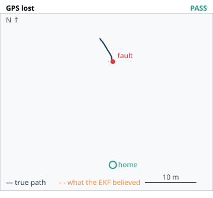
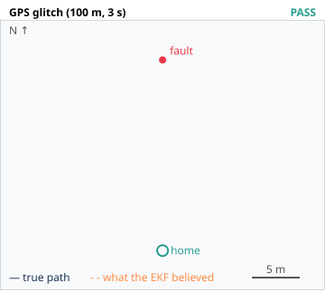
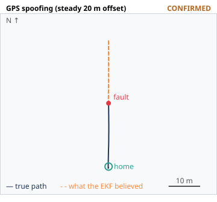
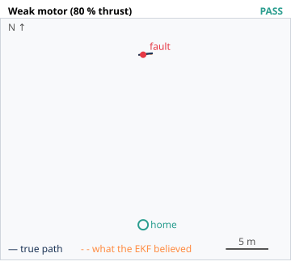
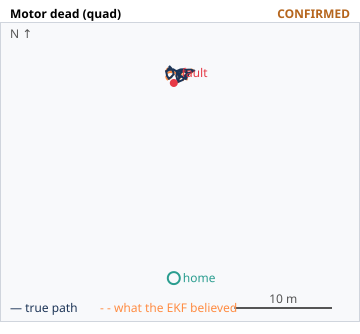
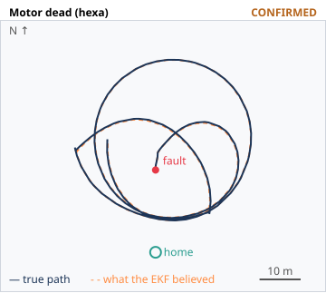
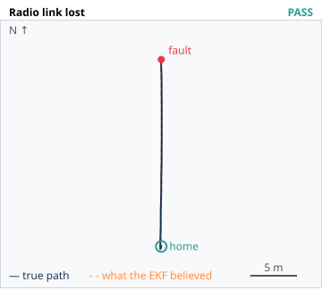
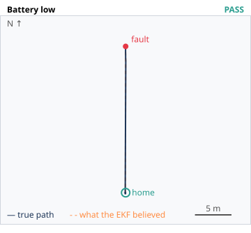
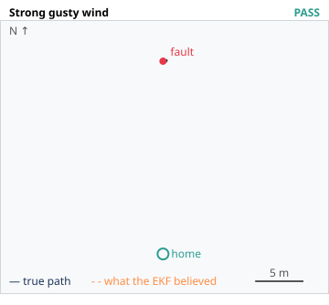
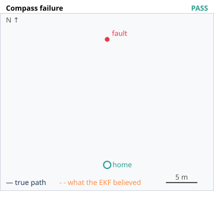
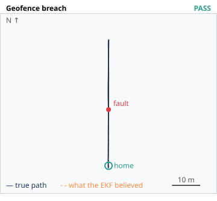

## Timelines (seconds after the fault)

**GPS lost**: +7.9 s EKF3 lane switch 1; +7.9 s EKF primary changed:1; +8.0 s mode LAND; +8.0 s EKF variance; +8.0 s EKF Failsafe: changed to Land Mode; +15.1 s EKF3 IMU0 stopped aiding; +15.1 s EKF3 IMU1 stopped aiding; +22.3 s SmartRTL deactivated: bad position; +32.2 s SIM Hit ground at 0.499031 m/s; +34.3 s Disarming motors; +34.3 s EKF primary changed:0

**GPS glitch (100 m, 3 s)**: +0.2 s EKF3 lane switch 1; +0.2 s EKF primary changed:1; +0.6 s EKF3 lane switch 0; +0.6 s EKF primary changed:0; +1.3 s GPS Glitch or Compass error; +3.1 s fault cleared; +13.5 s Glitch cleared

**GPS spoofing (steady 20 m offset)**: +0.2 s EKF3 lane switch 1; +0.2 s EKF primary changed:1; +1.3 s GPS Glitch or Compass error; +15.1 s fault cleared

**Weak motor (80 % thrust)**: 

**Motor dead (quad)**: +1.7 s SIM Hit ground at 10.68085 m/s; +3.5 s SIM Hit ground at 2.697049 m/s; +5.3 s SIM Hit ground at 2.570622 m/s; +6.9 s SIM Hit ground at 2.837447 m/s; +8.7 s SIM Hit ground at 2.716168 m/s; +9.7 s SIM Hit ground at 2.668299 m/s; +11.3 s SIM Hit ground at 2.803540 m/s; +12.9 s SIM Hit ground at 1.956977 m/s; +14.2 s SIM Hit ground at 2.260315 m/s; +15.8 s SIM Hit ground at 2.815172 m/s; +17.6 s SIM Hit ground at 2.679573 m/s; +18.6 s SIM Hit ground at 2.643040 m/s

**Motor dead (hexa)**: +3.1 s Potential Thrust Loss (1); +19.9 s SIM Hit ground at 0.556861 m/s; +24.9 s SIM Hit ground at 1.951807 m/s; +29.2 s SIM Hit ground at 1.923968 m/s

**Radio link lost**: +1.1 s mode RTL; +1.1 s Radio Failsafe; +44.0 s SIM Hit ground at 0.498811 m/s; +46.1 s Disarming motors; +47.7 s PreArm: Radio failsafe on

**Battery low**: +10.2 s mode RTL; +10.2 s Battery 1 is low 10.80V used 256 mAh; +10.2 s Battery Failsafe; +53.1 s SIM Hit ground at 0.500298 m/s; +55.3 s Disarming motors; +55.4 s PreArm: Battery 1 low voltage failsafe; +55.4 s PreArm: Battery failsafe

**Strong gusty wind**: 

**Compass failure**: +10.0 s EKF3 IMU0 switching to compass 1; +10.0 s EKF3 IMU1 switching to compass 1

**Geofence breach**: +8.4 s mode RTL; +8.4 s Circle fence breached; +8.4 s Manual recovery started; +15.3 s Fence breach cleared; +54.0 s SIM Hit ground at 0.500630 m/s; +56.1 s Disarming motors
